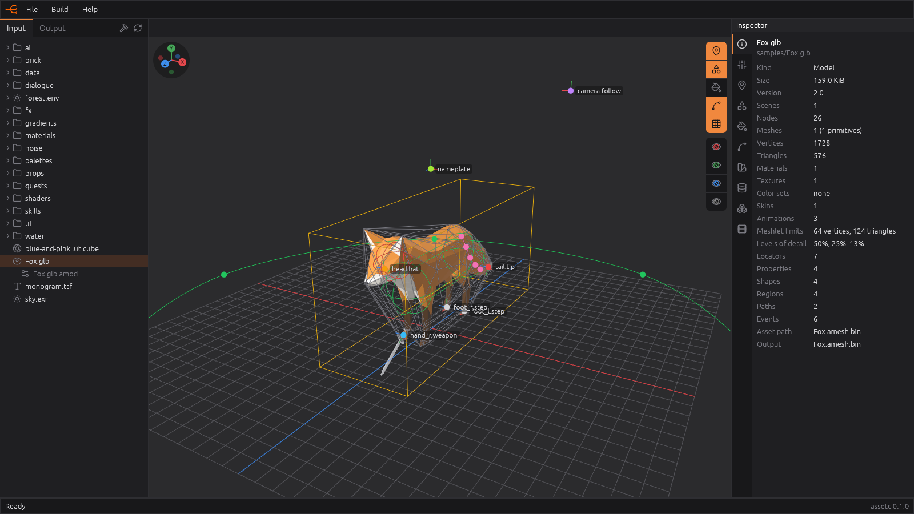
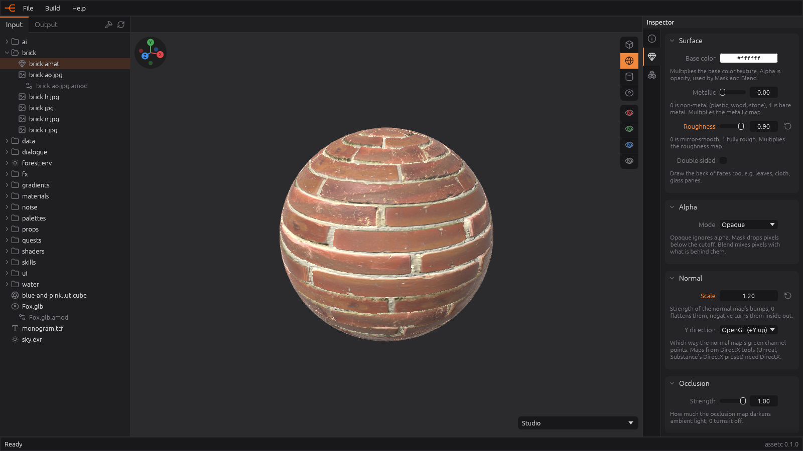
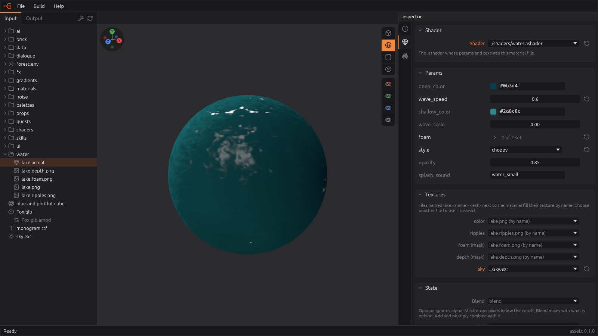
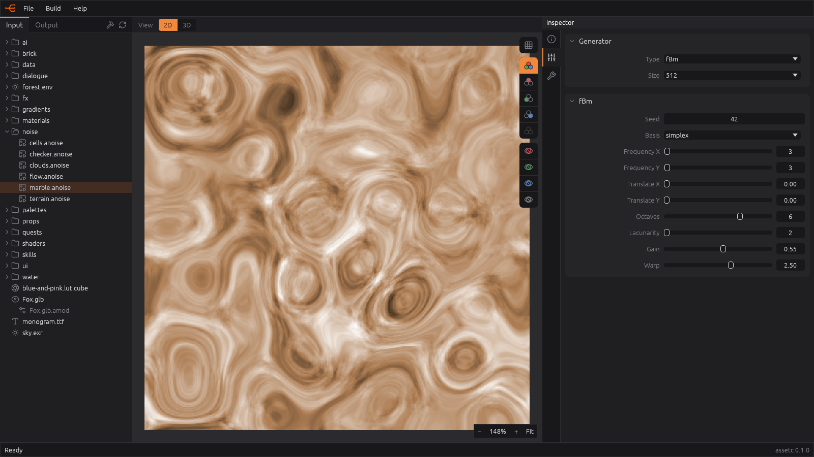
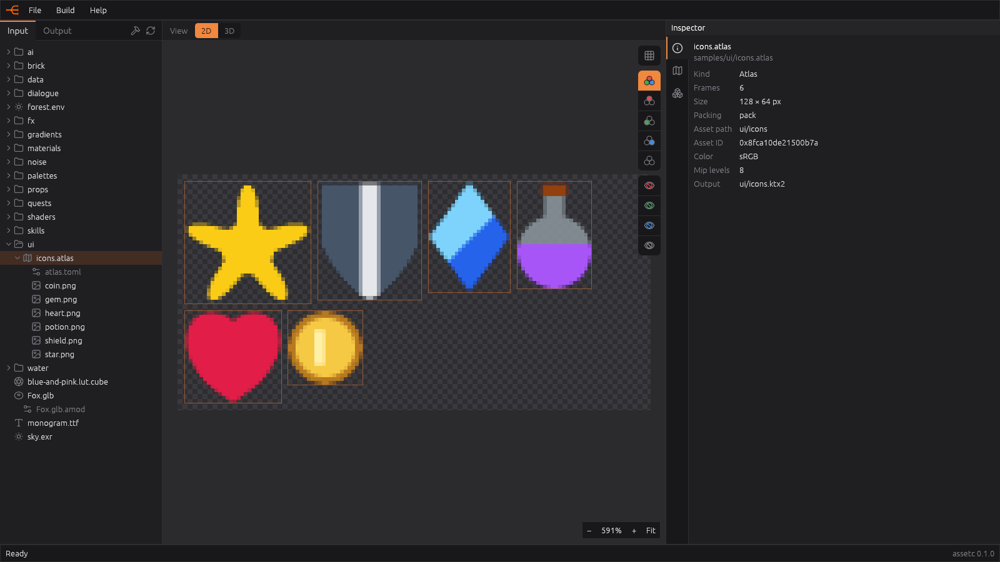
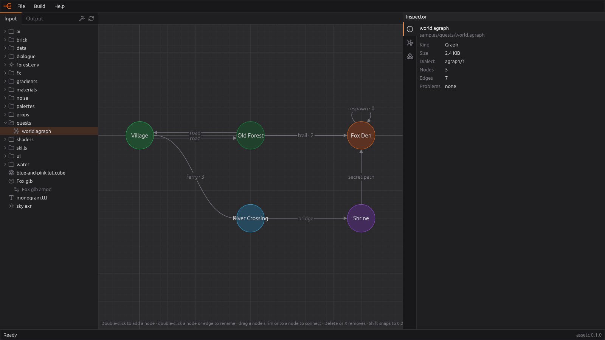
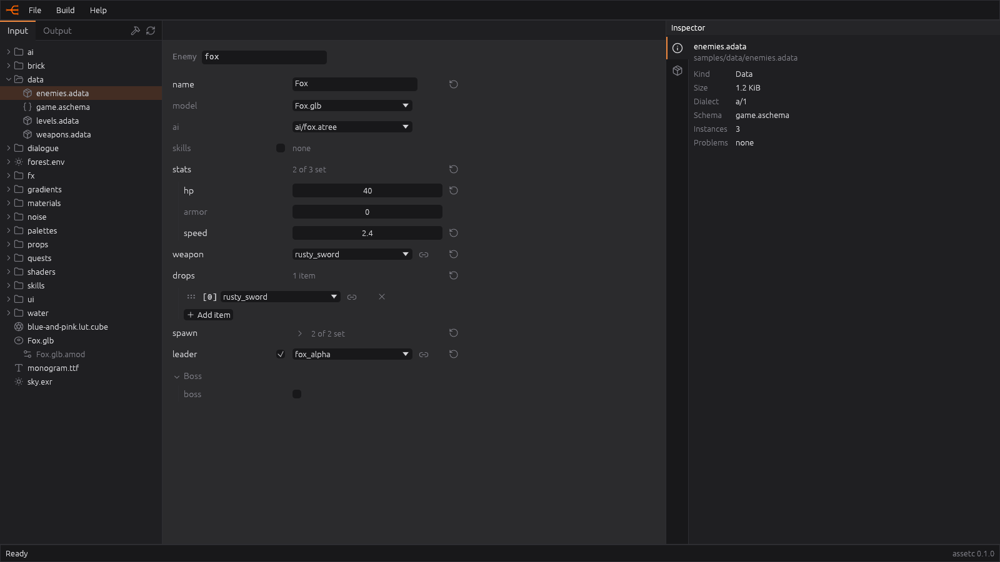
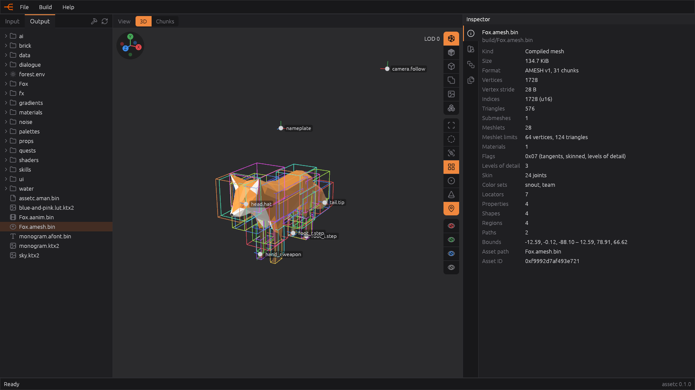

# Asset Compiler

`assetc` compiles source assets (textures, meshes, shaders, materials, fonts) into runtime-friendly binary formats for video games. Supports octahedral-packed normals/tangents and meshletized geometry; mesh files reference materials by stable 64-bit hashes so the engine can share resources across assets. Mesh additionally emits a companion material table plus one content-addressed .ktx2 per referenced image. Embedded textures are written to a shared flat store keyed by content, so the same texture used by two different models is encoded once and shares one runtime handle.

Texture refs are stored as 64-bit hashes, not paths. A single global manifest maps each hash back to the file on disk. Load it once into a hash → path map and you can resolve any asset by a stable id - textures (baseColorTex etc.), but also meshes, materials, animations, fonts, shaders, and embeds - through one uniform lookup.

Everything assetc writes has a detailed spec under [`docs/spec/`](docs/spec/), and every feature under [`docs/features/`](docs/features/). Games read the output with the [`assetc` crate](#sdk-the-assetc-crate), a small runtime SDK with no dependencies.



| | |
|---|---|
|  |  |
| **PBR materials**: `.amat` with textures found by name, previewed on a sphere | **Custom materials**: an `.acmat` for your own SPIR-V shader, its params and textures |
|  |  |
| **Generated textures**: noise, patterns, gradients and palettes from parameters | **Atlases**: a folder of images packed into one texture with named frames |
|  |  |
| **Graphs and trees**: quest maps, dialogue, AI, edited on the canvas | **Data**: typed instances of your schemas, with references to assets and other instances |



The **Output** tab inspects what the build wrote: here `Fox.amesh.bin` with its meshlet bounds, levels of detail, skin and locators.

## Commands

| Command | What it does |
|---------|--------------|
| `assetc` | Open the GUI for the project containing the current directory. |
| `assetc init` | Write a starter `assetc.toml` in the current directory (never overwrites one). |
| `assetc build` | Compile `input` into `output`; `--target <name>` builds a [target](#targets) instead. |
| `assetc watch` | Build, then rebuild what changes until stopped (`Ctrl+C`); `--target <name>` too. |
| `assetc pack` | Build, then bundle the output into one `.pak` file; `--target <name>` too. |
| `assetc --help`, `--version` | Usage, version. |

Like git with `.git`, assetc finds its project by looking for `assetc.toml` in the current directory and its parents. See [docs/features/cli.md](docs/features/cli.md).

`assetc watch` keeps the output up to date while you edit: after the first build it compiles only the assets whose settings or source files changed (a data file also when a schema changes, a `.gltf` when any file in its folder does).

### Make targets

| Target | Does |
|--------|------|
| `make run` / `make build` / `make release` | `cargo run`, debug build, release build |
| `make install` | Release build, copied to `~/bin/assetc` |
| `make demo` | Packs the samples, then shows them in the [demo](#demo) |
| `make publish-check` / `make publish` | Dry run / publish of the [`assetc` crate](#sdk-the-assetc-crate) to crates.io |

## Configuration (`assetc.toml`)

Every key is optional; an empty file builds `assets/` into `build/`. Full reference: [docs/spec/assetc.toml.md](docs/spec/assetc.toml.md).

```toml
input = "samples"          # source assets (default "assets")
output = "tmp/build"       # compiled assets (default "build")

[textures]                 # globs over the input-relative path
linear = ["**/*_n.png"]    # linear data, not sRGB color
no_mipmaps = ["ui/**"]
volume_luts = []           # .cube LUTs as 3D textures instead of strips

[meshes]
meshlet_max_vertices = 64
meshlet_max_triangles = 124
lod_ratios = [0.5, 0.25]   # levels of detail, as fractions of the triangles

[pack]
alignment = 4096           # page-aligned files, for memory mapping
exclude = ["**/*.orm.ktx2"]

[targets.mobile]           # assetc build --target mobile -> tmp/build-mobile
textures = { no_mipmaps = [] }
meshes = { lod_ratios = [0.5] }
```

### Targets

A target is a named variant of the settings: its keys replace the top-level ones (tables merge key by key), and it builds into its own output, `<output>-<name>` unless it sets one. Every target shares the input.

Per-file settings live next to the file in an [`.amod`](docs/spec/amod.md) sidecar (`Fox.glb.amod`): a model's mesh settings, locators, properties, shapes, regions, paths, vertex colors and animation events, a texture's modifiers, and attached structs, edited in the GUI's inspector.

## Supported inputs

| Source | Asset | Output |
|--------|-------|--------|
| `*.png`, `*.jpg`, `*.jpeg`, `*.tga` | texture | `.ktx2` ([textures](docs/features/textures.md)) |
| `*.anoise` | generated texture: noise and patterns | `.ktx2` ([noise](docs/features/noise.md)) |
| `*.agradient` | generated texture and gradients | `.ktx2` + `.agradient.bin` ([gradients](docs/features/gradients.md)) |
| `*.apalette` | generated texture and named colors | `.ktx2` + `.apalette.bin` ([palettes](docs/features/palettes.md)) |
| folder `*.atlas` | packed texture and frames | `.ktx2` + `.aatlas.bin` ([atlases](docs/features/atlases.md)) |
| `*.exr` | HDR environment cubemap | `.ktx2` ([HDR](docs/features/hdr.md)) |
| `*.cube` | color LUT, as a strip or 3D texture | `.ktx2` ([LUT](docs/features/lut.md)) |
| `*.amat` and textures by name (`brick.jpg`, `brick.n.jpg`, `brick.r.jpg`, …) | PBR material, ORM packed | `.amat.bin` + `.ktx2` ([materials](docs/features/materials.md)) |
| `*.ashader` + SPIR-V stages | shader interface | `.ashader.bin` ([custom materials](docs/features/custom-materials.md)) |
| `*.acmat` and textures by name | custom material | `.acmat.bin` ([custom materials](docs/features/custom-materials.md)) |
| `*.gltf`, `*.glb` | mesh with meshlets and LODs, materials, textures, skin, animations | `.amesh.bin`, `.aanim.bin`, `<model>/…` ([models](docs/features/models.md)) |
| `*.ttf`, `*.otf` | SDF font | `.afont.bin` + `.ktx2` atlas ([fonts](docs/features/fonts.md)) |
| `*.aschema` | types for data | `.aschema.bin` ([schemas](docs/features/schemas.md)) |
| `*.adata` | instances of a schema, resolved | `.adata.bin` ([instances](docs/features/instances.md)) |
| `*.agraph` | directed graph | `.agraph.bin` ([graphs](docs/features/graphs.md)) |
| `*.atree` | tree | `.atree.bin` ([trees](docs/features/trees.md)) |

Anything else is skipped. For `samples/Fox.glb` the build writes:

```
build/Fox.amesh.bin        geometry, meshlets, levels of detail, skin, locators
build/Fox.aanim.bin        animation clips, with events
build/Fox/…                the model's materials (.amat.bin) and textures (.ktx2)
build/assetc.aman.bin      every asset ID -> output file (all assets, written once)
```

Asset IDs are `FNV-1a-64` of the asset path (`textures/Grass.png` -> `textures/Grass`), so they are stable across builds and source formats. See [docs/features/build.md](docs/features/build.md#asset-ids).

## File formats

Every binary format is little-endian. Most are [chunked files](docs/spec/chunks.md): a header naming the format and version, then tagged chunks a reader can skip.

| Format | Spec | Holds |
|--------|------|-------|
| `.ktx2` | [ktx2.md](docs/spec/ktx2.md) | Textures: 2D, cubemaps, volume LUTs, with mipmaps and their usage |
| `.amesh.bin` | [amesh.bin.md](docs/spec/amesh.bin.md) | Mesh: vertices with octahedral normals and tangents, meshlets, LODs, skin, skeleton, locators, shapes, regions, paths |
| `.aanim.bin` | [aanim.bin.md](docs/spec/aanim.bin.md) | Animation clips of a skinned mesh, with events |
| `.amat.bin` | [amat.bin.md](docs/spec/amat.bin.md) | PBR material: factors and texture IDs |
| `.ashader.bin` | [ashader.bin.md](docs/spec/ashader.bin.md) | Shader interface: params block layout, textures, render state, SPIR-V stages |
| `.acmat.bin` | [acmat.bin.md](docs/spec/acmat.bin.md) | Custom material: shader ID, GPU block bytes, texture IDs |
| `.afont.bin` | [afont.bin.md](docs/spec/afont.bin.md) | Font metrics, glyphs and kerning beside an SDF atlas |
| `.aatlas.bin` | [aatlas.bin.md](docs/spec/aatlas.bin.md) | Atlas frames by name |
| `.agradient.bin` | [agradient.bin.md](docs/spec/agradient.bin.md) | Gradients by name, to sample at runtime |
| `.apalette.bin` | [apalette.bin.md](docs/spec/apalette.bin.md) | Colors by name or index |
| `.aschema.bin` | [aschema.bin.md](docs/spec/aschema.bin.md) | Types, fields and enums |
| `.adata.bin` | [adata.bin.md](docs/spec/adata.bin.md) | Instances with every field resolved |
| `.agraph.bin` | [agraph.bin.md](docs/spec/agraph.bin.md) | Directed graph: nodes, edges, their data |
| `.atree.bin` | [atree.bin.md](docs/spec/atree.bin.md) | Tree, nodes breadth-first |
| `assetc.aman.bin` | [aman.bin.md](docs/spec/aman.bin.md) | Manifest: every asset ID -> output file |
| `.pak` | [pak.md](docs/spec/pak.md) | The whole output in one file, each asset readable (or memory-mapped) in place |

Many assets can carry [attached structs](docs/features/structs.md): values of your own schema types on the asset, a node, an edge or a color ([astruct.md](docs/spec/astruct.md)).

The source formats assetc reads and its GUI writes are specified too: [`.amat`](docs/spec/amat.md), [`.acmat`](docs/spec/acmat.md), [`.ashader`](docs/spec/ashader.md), [`.amod`](docs/spec/amod.md), [`.anoise`](docs/spec/anoise.md), [`.agradient`](docs/spec/agradient.md), [`.apalette`](docs/spec/apalette.md), [`atlas.toml`](docs/spec/atlas.toml.md), and the data files of the [a/1 property format](docs/aschema.md) ([`.aschema`](docs/spec/aschema.md), [`.adata`](docs/spec/adata.md), [`.agraph`](docs/spec/agraph.md), [`.atree`](docs/spec/atree.md)).

## GUI

`assetc` with no arguments opens the editor: the input and output trees on the left, a 2D/3D preview in the middle and the inspector on the right.

- Previews inputs and outputs: textures with their channels, models with locators and levels of detail, materials on a sphere or other shapes, fonts, atlases, graphs and trees.
- Edits the source files it understands: materials, custom materials and shaders, noise, gradients, palettes, schemas, data instances, graphs, trees, and `.amod` settings (locators, properties, shapes, regions, paths, animation events).
- Creates, renames, deletes and moves files (drag and drop, with their companion files and with paths fixed across the project).
- Builds with `Ctrl+B` and marks each file's build result in the tree.

Keybindings: [KEYS.md](KEYS.md). Layout and look: [docs/features/gui.md](docs/features/gui.md).

## SDK: the `assetc` crate

[`sdk/`](sdk/) is the `assetc` crate on crates.io: the runtime side of assetc, for the game. It reads every output format above, from a `.pak` or an output directory, into plain Rust values. It depends on **nothing but `std`**: no Bevy, glTF, meshoptimizer, image or shader crates, and none of the compiler's code.

```toml
[dependencies]
assetc = "0.1"
```

```rust
use assetc::{Assets, Kind, Mesh, Texture};

let assets = Assets::open("build/assetc.pak")?;     // or the output directory
for entry in assets.of_kind(Kind::Mesh) {
    let mesh: Mesh = assets.load(entry.id)?;          // by asset ID
    println!("{}: {} vertices", entry.path, mesh.vertices.len());
}
let texture: Texture = assets.load_path("ui/fire.ktx2")?;
```

The compiler itself is the unpublished `assetc-core` package at the repository root (its binary is `assetc`). See [docs/features/sdk.md](docs/features/sdk.md) and [sdk/README.md](sdk/README.md).

## Sample assets

[`samples/`](samples/) is a project with an input of every kind, used by the tests, the screenshots and the demo. Most of it was made for assetc; the third-party assets (the Khronos Fox model, the monogram font, …) and their licenses are listed in [NOTICE.md](NOTICE.md).

## Demo

`make demo` packs the samples and opens [`demo/`](demo/), a small Bevy app that shows every sample through the SDK only, the way a game would load them. See [docs/features/demo.md](docs/features/demo.md).
